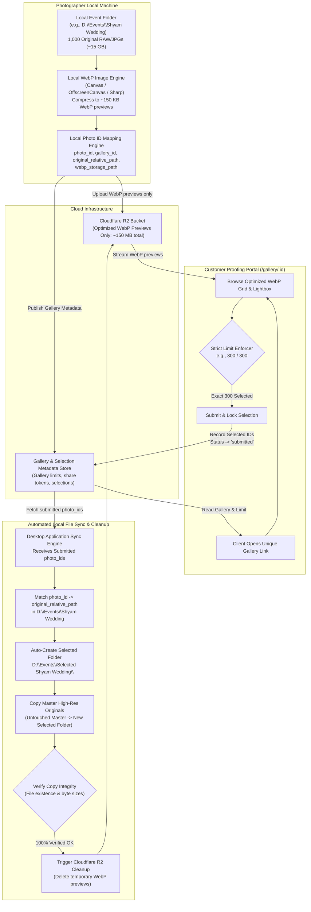

# ZeeBook Studio — Professional Photo Selection & Proofing Platform

> **High-Performance Online Proofing & Automated Original File Retrieval for Photography Studios**

---

## 1. System Overview & The Core Problem

Professional wedding and event photographers frequently capture **1,000 to 2,000+ high-resolution RAW/JPG photos** (~15 MB to 50 MB each, totaling 15–50 GB per event). In contrast, clients often only require an agreed number of final selections (e.g., **200 to 300 photos**) for custom photo album design and color grading.

Historically, clients had to travel in person to the studio to click through photos manually on the photographer's workstation. This inefficient workflow wasted days of studio time and customer convenience.

### The Solution
This platform bridges local desktop processing with a fast, zero-egress cloud proofing experience:
1. **Local Previews Only**: The photographer's machine generates optimized, lightweight WebP previews (~100–180 KB each).
2. **Cloudflare R2**: Only these WebP previews are uploaded to Cloudflare R2 object storage. **15+ MB original files are never uploaded to the cloud.**
3. **Strict Client Selection Rules**: The customer receives a shareable gallery link (`/gallery/:id`) and can select **EXACTLY the photographer-defined limit** (e.g., `300 / 300`). They are prohibited from selecting 301 or submitting 299.
4. **Automated Original File Matching & Safe Copy**: Once submitted, the photographer's local desktop application matches the selected photo IDs with the original files on local disk and automatically copies the **ORIGINALS** into a new dedicated folder (e.g., `Selected Shyam Wedding`). The original master folder remains untouched.
5. **Verified Cloud Cleanup**: Only after local file copy integrity is verified 100% are the temporary WebP previews pruned from Cloudflare R2.

---

## 2. End-to-End Workflow Architecture



---

## 3. Strict Architecture Principles

### A. Separation of Concerns
1. **Original Master Files**:
   - Reside strictly on the photographer's local storage (`D:\Events\...`).
   - High-resolution (15–50 MB each).
   - **NEVER uploaded to cloud.**
   - **NEVER modified or deleted.**
2. **WebP Proofing Previews**:
   - Generated locally on the photographer's machine.
   - Ultra-fast WebP format (~100–180 KB each).
   - Temporary assets hosted on Cloudflare R2.
3. **Gallery Metadata & Selection State**:
   - Persists gallery configuration, selection limits, and selected photo IDs.
4. **Selected Original Deliverables**:
   - A newly created local folder (`D:\Events\Selected [Event Name]\`).
   - Contains a verified exact copy of the **original camera files** corresponding to customer-selected IDs.

### B. Cloudflare R2 Storage (Zero Egress Costs)
- Supabase is explicitly **not** used.
- Cloudflare R2 provides S3-compatible APIs and eliminates bandwidth egress fees when thousands of customer preview images are streamed.
- Temporary preview lifecycle: Once the desktop tool confirms that all selected master files are copied locally, an automated batch deletion purges the previews.
- Safety net: An R2 bucket lifecycle rule (e.g., 30-day auto-purge) guarantees zero orphaned preview storage even if a client abandons an event.

### C. Unique Stable Photo ID Mapping
Do **NOT** rely on filenames alone (camera duplicate names like `IMG_0001.JPG` across different cards must not collide).
Every item is tracked through an immutable mapping record:
```json
{
  "photo_id": "p_shyam_0456_8f3d1a",
  "gallery_id": "gal_shyam_wedding_2026",
  "original_filename": "IMG_0456.JPG",
  "original_relative_path": "Camera1/IMG_0456.JPG",
  "original_size_bytes": 15728640,
  "webp_storage_path": "galleries/gal_shyam_wedding_2026/p_shyam_0456_8f3d1a.webp",
  "webp_size_bytes": 142100,
  "dimensions": { "width": 2400, "height": 1600 }
}
```

### D. Strict Client Selection Rules
- The photographer sets `selection_limit` independently of total uploaded photo count.
  - Example: Uploaded = `1000`, Selection Limit = `300`.
- The customer UI provides real-time tracking:
  - If selection is `299 / 300`: Submission button disabled with dynamic banner *"Please select 1 more photo before submitting."*
  - If user attempts to select a 301st photo: Prevent selection, display *"Selection limit reached. You can select a maximum of 300 photos."*
  - Only when count is **EXACTLY 300 / 300** can the selection be submitted.

---

## 4. Visual Design Language: ZeeBook Studio ERP

The user interface follows the **ZeeBook Studio ERP** design aesthetic:
- **Theme**: Dark navy / near-black foundation (`#090D16`, `#0F172A`, `#131C31`).
- **Accent**: Electric royal blue (`#2563EB`, `#3B82F6`) with indigo and cyan neon micro-accents.
- **Structure**:
  - Collapsible left sidebar navigation.
  - Studio top-bar with active status, storage metrics, quick search, and role switcher.
  - Card-based ERP dashboard with rounded corners, subtle glassmorphic borders (`rgba(255, 255, 255, 0.08)`), and soft drop shadows.
  - High-density information displays: gallery statuses, upload bandwidth savings, and sync logs.
  - Decoupled, branded customer gallery experience with zero administrative clutter.

---

## 5. Project Directory Structure

```
photo-selection/
├── .env.example                  # Environment configuration template (R2 credentials, etc.)
├── .gitignore                    # Secrets, node_modules, and cache exclusion
├── README.md                     # Architecture documentation and roadmap
├── package.json
├── vite.config.ts
├── index.html
├── src/
│   ├── types/                    # Core TypeScript schemas & domain interfaces
│   │   └── index.ts              # Gallery, Photo, PhotoMapping, SyncJob, R2Config
│   ├── services/                 # Decoupled service layer
│   │   ├── storage/              # Cloudflare R2 & Storage adapters (IStorageService)
│   │   ├── database/             # Gallery & selection data store (IDatabaseService)
│   │   ├── image/                # Local WebP compression engine (IImageProcessorService)
│   │   ├── sync/                 # Local original file matcher & copier (ILocalSyncService)
│   │   └── cleanup/              # Post-sync Cloudflare R2 cleanup service
│   ├── data/
│   │   └── mockData.ts           # Rich demo studio data (Shyam Wedding 1000/300 example)
│   ├── components/
│   │   ├── studio/               # ZeeBook Studio ERP components
│   │   │   ├── Sidebar.tsx       # Studio navigation
│   │   │   ├── Header.tsx        # Studio topbar with stats and view switcher
│   │   │   ├── DashboardOverview.tsx # Metrics, recent galleries, storage savings
│   │   │   ├── CreateGalleryModal.tsx # Multi-step gallery creation & folder picker
│   │   │   ├── GalleryDetailView.tsx # Gallery inspection, copy originals & cleanup triggers
│   │   │   └── StorageSettingsView.tsx # Cloudflare R2 connection & lifecycle settings
│   │   ├── customer/             # Customer Proofing Portal
│   │   │   ├── CustomerGalleryView.tsx # Interactive proofing grid with strict limit enforcer
│   │   │   ├── PhotoCard.tsx     # WebP card with select badge & zoom preview
│   │   │   ├── PhotoLightbox.tsx # Full-screen preview with keyboard navigation
│   │   │   └── SubmitModal.tsx   # Final submission & confirmation dialog
│   │   └── common/               # Shared badges, modals, toast alerts
│   ├── styles/
│   │   └── index.css             # Vanilla CSS design token system & ERP stylesheet
│   ├── App.tsx                   # Main application router & state controller
│   └── main.tsx                  # React DOM mount point
```

---

## 6. Development Roadmap

### Phase 1: Architecture, Core Types, & Foundation UI (Current)
- [x] Workspace initialization, git configuration, and security rules (`.gitignore`, `.env.example`).
- [x] Full architecture documentation and data flow specifications.
- [x] Domain types and decoupled service interfaces (`IStorageService`, `ILocalSyncService`, `IImageProcessorService`, `IDatabaseService`).
- [x] ZeeBook Studio ERP dark navy design system in Vanilla CSS.
- [x] Studio Dashboard overview (KPIs, galleries, storage stats).
- [x] "Create Gallery" multi-step workflow with folder detection and limit configuration.
- [x] Customer Proofing Portal with exact selection limiter (e.g. 300 / 300), 301-blocker alert, and submission blocker.
- [x] View switcher for seamless testing of both Photographer and Client perspectives.

### Phase 2: Local Processing Engine & File System Access
- [ ] Browser Native File System Access API integration (`window.showDirectoryPicker()`) for direct local folder reading.
- [ ] Local client-side WebP converter using HTML5 Canvas & Web Workers with configurable quality slider.
- [ ] Photo ID hashing and mapping engine.
- [ ] Export directory generator for copying original files locally.

### Phase 3: Cloudflare R2 Integration & Cloud Cleanup
- [ ] Cloudflare R2 S3-compatible client (`@aws-sdk/client-s3`) integration.
- [ ] Pre-signed URL upload generator for direct browser-to-R2 WebP preview uploads.
- [ ] Safe batch deletion after local copy verification.
- [ ] Bucket lifecycle configuration documentation.

### Phase 4: Desktop Companion / Electron Packaging
- [ ] Optional Electron or Tauri wrapper for high-throughput background RAW/CR3/NEF file reading and multi-threaded WebP processing via Libvips / Sharp.
- [ ] Automated local watcher for submitted galleries and one-click copy.
